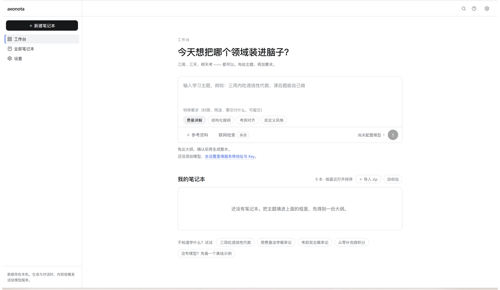
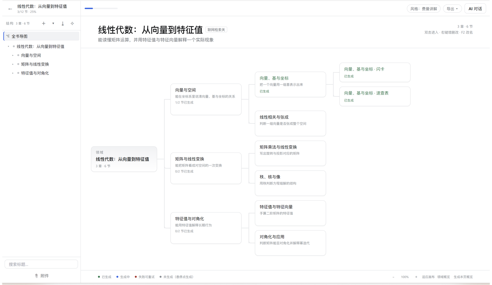
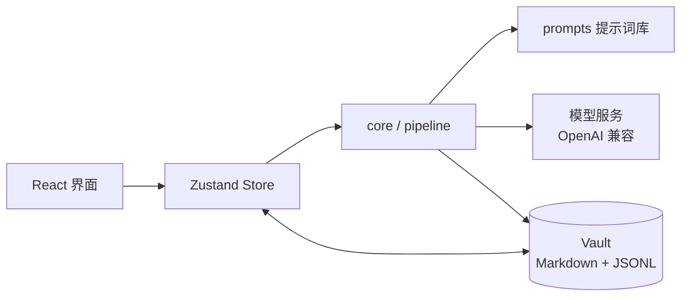

<p align="center">
  
</p>

<h1 align="center">Axonota Studio</h1>

<p align="center">
  把「学一个领域」变成一本能读、能问、能复习的本地笔记本。
</p>

<p align="center">
  <a href="#中文">中文</a> ·
  <a href="README.en.md">English</a> ·
  <a href="../../releases/latest">下载</a> ·
  <a href="#快速开始">快速开始</a>
</p>

<p align="center">
  
  
  
  
  
  
</p>

---

## 中文

### 这是什么

Axonota Studio 是一个 **本地优先（local-first）的 AI 学习笔记本**，Windows 桌面应用。

你给一个主题，它先和你确认学习范围，产出一份可编辑的目录树；确认后逐章逐节生成正文。生成出来的不是一段聊天记录，而是一本有结构、可回看、可追问、可导出的「书」。

数据全部落在本机 Markdown 与 JSONL 文件里。模型只在你生成或提问时按需接收相应内容，不做云端同步，也没有遥测。

### 截图

**工作台：一句主题，先出大纲，再成书**



**思维导图视图：结构、完成度、组件页一目了然**



### 核心能力

- **结构先行的生成**：主题 → 学习目标与范围 → 章 / 节大纲 → 逐节正文。大纲可以先改，确认后再生成，避免一气生成一大堆跑偏的内容。
- **整本 / 本章 / 本节批量生成**：未生成的节点可以后台排队，生成时可以先读已经出来的部分。
- **思维导图与结构树双视图**：看全局关系，也看完成度；节点支持拖动重排、重命名、AI 重构结构。
- **阅读 / 源码双模式**：正文是标准 Markdown（支持 LaTeX），渲染阅读与直接编辑随时切换，停止输入自动保存。
- **学习组件页**：闪卡、速查表、自定义页。数据是固定 JSON 结构，AI 只填内容，因此可以稳定翻卡、检索与复用。
- **与笔记本对话**：对话默认带着当前笔记本的结构与正文上下文；可开关联网检索，回答会标注依据页与本机资料。
- **划词即用**：选中正文后可高亮、问 AI、复制，或用「AI 追问」——举例、形象化解释、快速例题、拆成步骤、补个反例。
- **出处与附件**：每个小节可挂本机资料与网页来源，回答里能跳回具体依据。
- **导入 / 导出**：整本归档为 zip，支持导出 PDF、打印、导入 zip；删除进系统回收站。
- **中英双语 + 浅色 / 深色主题**：首次启动选择语言，设置里随时切换，AI 输出语言跟随界面。
- **自带模型配置**：任何兼容 OpenAI Chat Completions 的服务都能接入，添加时可先做连通性测试。

### 快速开始

#### 方式一：下载安装包

到 [Releases](../../releases/latest) 下载 `Axonota Studio_x.y.z_x64-setup.exe`，双击安装。

系统要求：Windows 10 / 11（自带 WebView2），无需单独安装运行时。

#### 方式二：从源码运行

需要：Node.js ≥ 20、Rust ≥ 1.77、Visual Studio Build Tools（C++ 桌面开发负载）。

```bash
git clone https://github.com/Guchigagu/axonota-studio.git
cd axonota-studio
npm install
npm run tauri dev -w @nb/desktop
```

打包安装程序：

```bash
npm run tauri build -w @nb/desktop
# 产物：apps/desktop/src-tauri/target/release/bundle/nsis/
```

> 提示：如果项目目录路径包含 `#` 等特殊字符，Rust/Tauri 构建可能失败，建议放在普通路径下构建。

#### 配置模型

打开 **设置 → 模型 → 添加模型**，填写：

| 字段 | 说明 |
|---|---|
| 名称 | 自定义显示名，例如「DeepSeek」 |
| Base URL | OpenAI 兼容地址，例如 `https://api.deepseek.com/v1` |
| API Key | 仅保存在本机 `settings.json`，不会上传 |
| 模型 ID | 例如 `deepseek-chat` |

保存前可点击「测试连通性」。支持 OpenAI、DeepSeek、Moonshot、自建网关等兼容服务。

#### 三步用起来

1. 在工作台写清主题与要求（时限、用途、要交付什么），点 ↑ 生成大纲；
2. 调整大纲，确认后生成；
3. 打开任意小节开始读；选中文字问 AI，或生成闪卡 / 速查表复习。

没有模型也可以先点「没有模型？先看一个离线示例」，直接体验完整结构与组件页。

### 数据与隐私

- 数据目录：`%APPDATA%\com.axonota.studio\vault`
- 一本笔记本一个文件夹：

```text
notebooks/<id>/
├── notebook.md      # 主题、风格、大纲与节点索引
├── nodes/<id>.md    # 每节正文（Markdown）
├── files/           # 附件
├── chat.jsonl       # 对话记录
└── settings.json    # 模型与界面设置
```

- API Key 只存本机；生成与对话时，相关上下文按需发送给你配置的模型服务。
- 无账号体系、无云同步、无遥测。备份 = 复制 `vault` 目录。

### 技术栈与结构

<p align="center">
  
</p>

```text
axonota-studio/
├── apps/desktop/        # Tauri 2 + React 18 + Vite + Tailwind + Zustand
│   ├── src/             # 界面：工作台、笔记本、阅读器、对话、思维导图
│   └── src-tauri/       # Rust 侧：文件、回收站、导出、系统调用
├── packages/core/       # 零依赖引擎：Vault、生成流水线、提示词装配、AI 客户端
├── prompts/             # 提示词库（按功能拆分，可单独审阅）
├── scripts/             # 自测脚本
└── docs/assets/         # README 图片
```



- **前端**：React 18、TypeScript、Vite、Tailwind、Zustand、CodeMirror、KaTeX
- **桌面**：Tauri 2（Rust、WebView2、rusqlite、trash）
- **引擎**：`packages/core` 不依赖任何第三方库，可在 Node 中独立跑自测

### 开发命令

```bash
npm run dev -w @nb/desktop       # 只跑前端（浏览器调试模式，自动注入示例数据）
npm run typecheck                # core + desktop 类型检查
npm run selftest                 # core 引擎自测
npm run tauri dev -w @nb/desktop # 完整桌面应用
npm run tauri build -w @nb/desktop
```

### 已知限制

- 目前只在 Windows 上构建与验证（Tauri 跨平台，但部分系统调用按 Windows 实现）。
- 模型需兼容 OpenAI Chat Completions 且支持流式输出。
- 不提供云同步与多人协作——这是有意为之，本地文件才是事实来源。

### 贡献

欢迎 Issue 与 PR。提交前请跑通：

```bash
npm run typecheck && npm run selftest
```

提示词改动请同步更新 `prompts/README.md`。

### License

[MIT](LICENSE)
